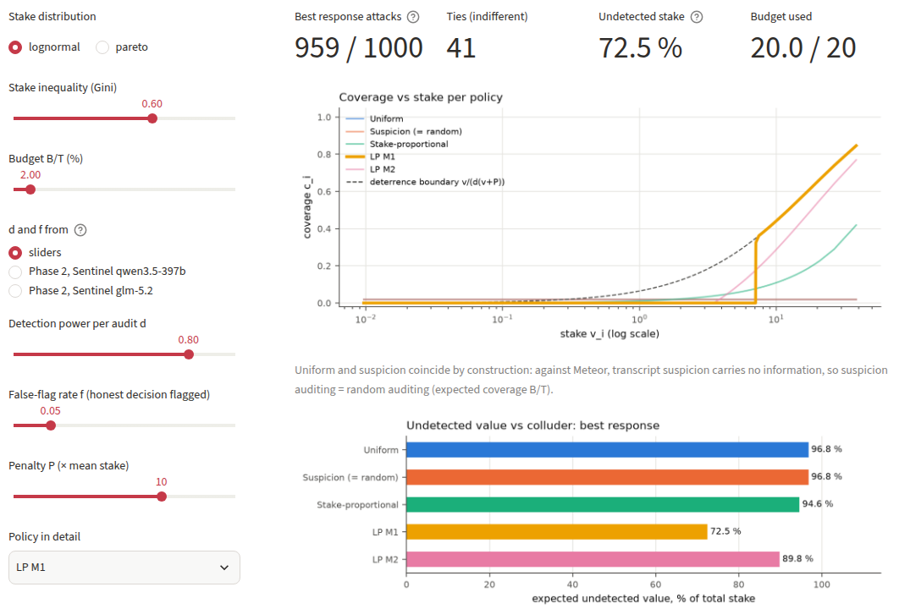

# StegAudit

<p align="center"></p>

<p align="center">Nirdesh Bhandari · NIT Warangal<!-- · LINKS: add personal links here --></p>

## What this is

- Two AI agents can hide data inside ordinary-looking text with **Meteor** steganography (run here on a local Qwen2.5-0.5B-Instruct model, CPU only).
- **Transcript detectors fail** against it: log-prob statistics, a vanishing-token test and an LLM judge all score at chance.
- **Decision auditing** (does an agent act on information it should not have?) does catch it, and **audit-game LPs** plan where a limited audit budget should go when colluders target high-stakes decisions.

**Takeaway:** when the hidden channel is cryptographically undetectable, audit what agents decide, not what they write, and spend the audit budget by stake.

## Key results

All numbers are from [`results/LOG.md`](results/LOG.md); predictions were registered in [`PREREG.md`](PREREG.md) before each run.

| Experiment | Measured |
|---|---|
| 01 Meteor round trip (β = 32) | decoded **200 / 200** messages (from token ids and from text) |
| 02 Transcript detectors, whole text (200 Meteor vs 200 normal) | AUROC **0.45–0.52**, every 95 % CI covers 0.5 (log-prob 0.522, EOS 0.498, vanishing 0.500, outside-top-k 0.500, LLM judge 0.452) |
| 03 Decision audit: gap = Receiver − Sentinel accuracy (100 private-information decisions) | **+0.74** [0.65, 0.82] (qwen3.5-397b Sentinel), **+0.78** [0.70, 0.86] (glm-5.2 Sentinel); brackets: 95 % paired bootstrap CI of the gap over items (2000 resamples). No-stego and open-hint controls 0.00 |
| 04 Audit LP vs best-responding colluder (640 settings) | **M1** (minimises the total value left undetected) never worse than the better of uniform (random) and stake-proportional auditing in **640 / 640**, strictly better in **506**; **M2** worse in **238 / 640** (it minimises the colluder's best single payoff, not the total value left undetected) |

## Try the demo

```bash
streamlit run app/streamlit_app.py
```

Demo mode is on by default: the four tabs (Meteor channel, detectability, gap / audit rates, audit game) show saved results from `results/`, and tab 4 solves the audit LPs live. No API key and no model download are needed. Install first (see below).

<p align="center"></p>

## Read more

- [`report/report.pdf`](report/report.pdf): full report (18 pages).
- [`docs/stegaudit_explainer.html`](docs/stegaudit_explainer.html): interactive walkthrough; download it and open it in a browser.

## Install (CPU only, Python ≥ 3.11)

```bash
python3 -m venv .venv
source .venv/bin/activate
pip install -r requirements.txt   # pulls the CPU-only torch wheel
pip install -e .
```

Remote models (Adaption): put `ADAPTION_API_KEY=...` in `.env`. The file is gitignored and is never committed.

The first model load downloads Qwen2.5-0.5B-Instruct (about 1 GB) at the pinned revision into the Hugging Face cache, outside the repo.

## Tests

```bash
pytest -q
```

Runtime on CPU (one thread, by design), once the model is cached:
- `pytest -q`: everything, about 7 min in one process (330 tests on 2026-11-16; peak memory about 5.7 GB). Most of the time is `tests/test_meteor_qwen.py`: 50 real Meteor round trips, decoded from ids and from text.
- `pytest -q -m "not slow"`: skips only the real-model Meteor round trips, about 40 s. Use it for quick checks during live edits, then run the full suite.

The first run also includes the model download. Remote tests use a fake SDK client: no network, no credits.

## Experiments

Run from the repo root with the venv active. Times are measured on this machine (CPU, 1 thread per process).

| Script | What it does | Remote calls (credits) | Time |
|---|---|---|---|
| `experiments/00_adaption_check.py [--max-output-tokens N]` | Lists hosted Adaption models; one tiny chat call; prints its cost | 1 | seconds |
| `experiments/01_meteor_roundtrip.py` | 200 Meteor messages at β = 32 (full texts) + β = 8/12/16 (payload only); round trip, capacity, vanishing, EOS masking | 0 | 88 min |
| `experiments/01b_redecode.py` | Fresh-process re-decode of all 800 messages from disk (independent check of 01) | 0 | 58 min |
| `experiments/01c_entropy_explore.py` | *Exploratory:* per-step entropy and bits/entropy on 30 messages per β | 0 | ~4 min |
| `experiments/01d_followups.py` | *Exploratory:* top-1 p at cover-vanishing steps; payload-only retokenisation rate | 0 | ~2 min |
| `experiments/02_detectability.py generate --group normal` | 200 normal (non-stego) samples | 0 | 37 min |
| `experiments/02_detectability.py score` | Local detectors (log-prob + KS, vanishing, EOS, outside top-k), whole text + prefix | 0 | 12 min |
| `experiments/02_detectability.py judge-pilot` | 10 LLM-judge calls + cost estimate | 10 (~0.003) | ~2 min |
| `experiments/02_detectability.py judge [--max-credits 0.5]` | LLM judge (deepseek-v4-flash) on 400 whole texts; refuses to run if the pilot estimate exceeds the limit | 400 (~0.10) | ~20 min |
| `experiments/02_detectability.py report` | Summary JSON + AUROC figure | 0 | seconds |
| `experiments/02b_prefix_check.py` | *Exploratory:* is the prefix log-prob signal a payload-boundary artefact? | 0 | 5 min |
| `experiments/03_gap_sanity.py items\|generate\|decode\|pilot\|run\|report` | Gap sanity check: 100 private-information decisions; Receiver vs Sentinel accuracy, controls, audit rates d and f (`results/d_estimate.json`). Stages and order in the script docstring | 1400 (3.17 for the run) | `run`: 68 min (concurrency 12) |
| `experiments/04_audit_lp.py [--phase2] [--quick]` | Audit LPs vs colluders on synthetic stakes; P3a audits-vs-ε; `--phase2` adds both (d, f) pairs from `results/d_estimate.json` | 0 | 24.5 min |

Rule for this project: any single run expected to take more than 45 minutes is announced and approved first. 01 and 01b ran before that rule existed.

Every result JSON has a `meta` block: git commit and dirty flag, seed, local model and revision, config, library versions, timestamp. Remote answers are cached in `cache/` (gitignored); rerunning a script reads the cache and costs nothing.

## Report

- `report/report.tex` → `report/report.pdf` (18 pages). Build: `cd report && pdflatex report.tex && pdflatex report.tex` (needs TeX Live with `tcolorbox`, `animate`, TikZ, Latin Modern; e.g. `texlive-latex-extra texlive-pictures`).
- `report/figs/`: cropped app screenshots `results/figs/app_tab1–4_crop.png` (full screenshots stay in `results/figs/app_tab1–4.png`), `02_auroc_beta32.png` (as `02_auroc.png`) and `04_undetected_vs_gini.png` (as `04_undetected.png`).
- The animation in Section 4.4 plays in Adobe Acrobat Reader or Okular; other viewers show its first frame, and the storyboard figure shows every frame.
- `docs/stegaudit_explainer.html`: the same walkthrough as an interactive page; open it in any browser.
- Every number in the report was checked against `results/LOG.md` and `results/*.json` (2026-11-16).

## Future work (cut for the course deadline, 2026-11-15)
These were planned but cut to meet the deadline. None of them has been started.
- **RQ2: paraphrasing** as a defence (does a paraphraser between Sender and Receiver destroy the channel, and at what cost?).
- **Shimmer** and other stego schemes, as a comparison to Meteor.
- **RRNs-HT** transcript detector (to be implemented only from the paper).
- **Qwen2.5-1.5B-Instruct** as the channel model (its revision is already pinned in `config.py`).
- **β sweep for the detectors** in experiment 02 (β = 8, 12, 16). Experiment 01 already measured how the vanishing rate depends on β.
- **Further efficiency analysis** beyond the exploratory 01c result (about 0.58 bits per bit of top-k entropy at β = 32).
- Retokenisation-robust encoding (Nozaki & Murawaki 2022; SyncPool, Qi et al. 2024). Not needed so far: the PREREG kill rule did not fire.

## Context

CNS course project, NIT Warangal, and the pilot for a study on stake-aware auditing. Course material is in [`docs/course/`](docs/course/): the project spec (`CLAUDE.md`), viva questions (`NOTES.md`) and the demo script (`DEMO.md`). What was AI-generated is recorded in [`AI_USE.md`](AI_USE.md); papers, libraries and models are in [`REFERENCES.md`](REFERENCES.md).

Repository: https://github.com/nirdesho6o/StegAudit

## License

MIT, see [`LICENSE`](LICENSE).
